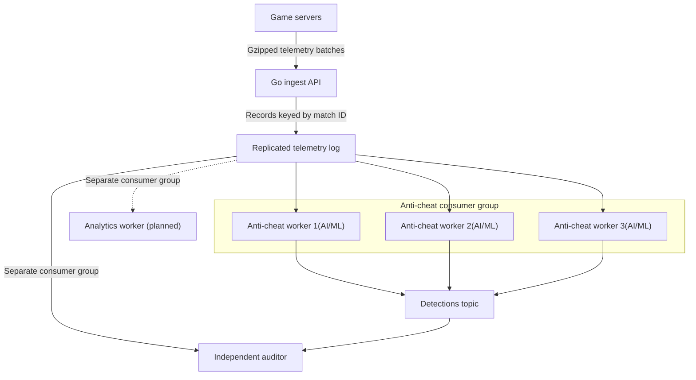

# GameSense - Anti-Cheat

**A distributed streaming pipeline for multiplayer game telemetry. Horizontally scaled workers consume events from a replicated Kafka-compatible log and detect cheating in real time.**

A patch drops. Players pile in. Later in the simulated week, a region goes dark and its servers all try to reconnect. GameSense uses those traffic spikes to test whether a distributed pipeline can keep detecting cheats and account for every event it acknowledges.

This repository is a public code sample from GameSense. It walks through the Go ingest API, the Kafka-compatible event log, and the detector and auditor that read from it. The benchmarks below come from the full project.

## Follow a shot through the pipeline



1. **Generate the traffic.** The simulator runs 55 game servers across three regions. Each region has its own evening peak. The scripted week adds a patch drop, a reconnect storm, and a tournament final.
2. **Acknowledge the write.** The Go API validates batches, rate-limits each server, and responds with success only after the broker acknowledges the write with `acks=all`. Under load, the API sends `Retry-After` and servers retry with jitter.
3. **Keep the match together.** Ingest keys records by `match_id`, so events for a match stay on one partition. Workers maintain per-player state and look for signals like aim snaps and impossible movement. A hot match can make one partition busier than the others.
4. **Make replays safe to handle.** Workers publish detections before committing offsets. A crash between those steps can replay events, so detections carry stable IDs that downstream consumers can use to deduplicate them.
5. **Check the receipts.** A separate auditor compares acknowledged sequence numbers with the raw events it reads. It also checks detections against the simulator’s ground truth to measure precision and recall.

> **The 5,640 m/s player.** In an early run, the detector flagged an innocent player for moving at 5,640 m/s. The simulator had put the same player ID into a match twice. Two players sharing one ID looked like one player teleporting.

## Where to start reading

| Path | What to look for |
| --- | --- |
| `internal/sim` | Regional load curves, batch retries, and per-server sequence numbers |
| `internal/ingest` | Per-server rate limits, a cap on in-flight requests, and broker acknowledgments |
| `internal/worker` and `internal/detect` | The consume → detect → publish → commit loop |
| `internal/audit` | How the auditor waits for every partition before checking a snapshot for missing events |

The local Compose setup described in the project uses a three-broker Redpanda cluster and the franz-go Kafka client. If your checkout includes the Makefile and service code, start with the ingest-only demo. It requires Go 1.24+ and runs without Docker.

```bash
# Run each command in a separate terminal
make p1-ingest
make p1-sim L=4
make stats
```

## How the full project performed

| Measurement | Result |
| --- | --- |
| Seven-day run | **20B+ events processed** |
| Peak detection throughput | **95K events/sec** at **18 ms p99** |
| Detection precision | **100%** against simulator ground truth in the measured run |
| Chaos tests | **Zero acknowledged events lost** across the tested broker, worker, and ingest pod failures and network partitions, verified by the auditor |

The full project also used a count-min sketch to flag abusive sources and short-lived OAuth 2.0 tokens bound to server IDs. Ingestion authenticated servers with mTLS and used a fixed-memory Bloom filter to reject replayed batches. Kubernetes game days exercised the pipeline under peak load.
